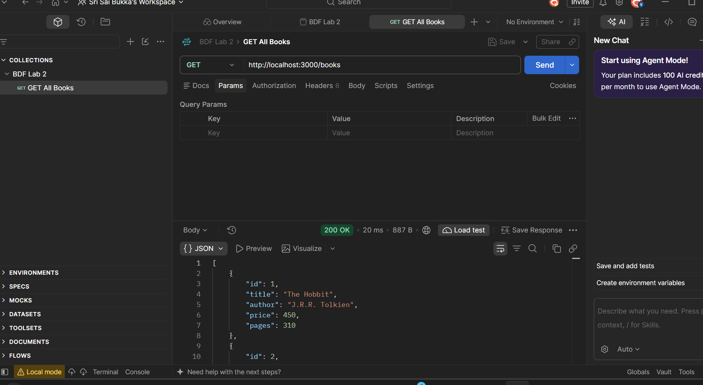
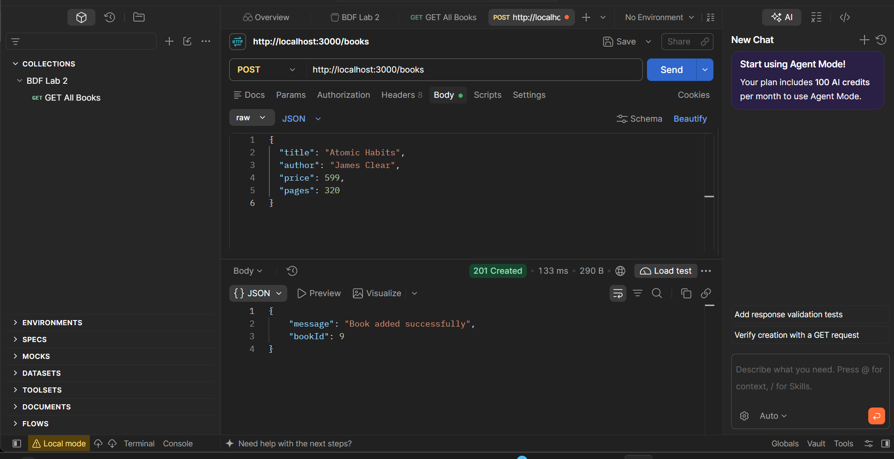
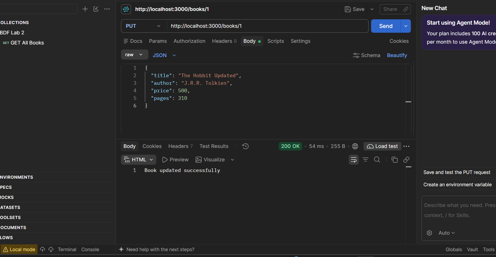
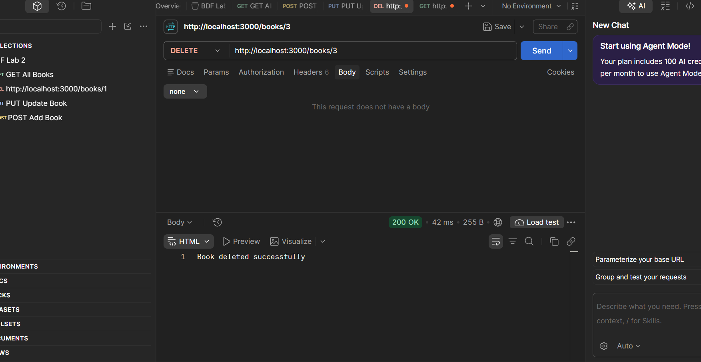
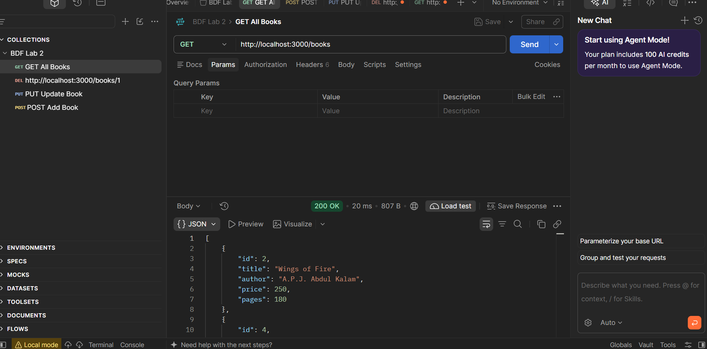

# Lab 2 – Library Management REST API

**Name:** Sri Sai Bukka  
**Registration Number:** 252U1R1046  
**Section:** CSE 2A  
**Subject:** Backend Development Frameworks

## 1. Project Description

This project implements a Library Management REST API using Node.js, Express.js and SQLite.

It demonstrates CRUD operations (Create, Read, Update and Delete) using a database.

## 2. Technologies Used

- Node.js
- Express.js
- SQLite
- Postman
- Visual Studio Code

## 3. Installation

Clone the repository and open the Lab 2 folder.

Install dependencies:

```bash
npm install
```

## 4. Run the Application

```bash
node app.js
```

Server URL:

http://localhost:3000

## 5. API Endpoints

| Method | Endpoint | Description |
|---|---|---|
| GET | /books | Retrieve all books |
| POST | /books | Add a new book |
| PUT | /books/:id | Update an existing book |
| DELETE | /books/:id | Delete a book |

## 6. Screenshots

### GET All Books


### POST Add Book


### PUT Update Book


### DELETE Book


### GET After Delete


## 7. Project Structure

```text
BDF lab 2/
├── screenshots/
│   ├── get-books.png
│   ├── post-book.png
│   ├── put-book.png
│   ├── delete-book.png
│   └── get-after-delete.png
├── postman/
├── app.js
├── db.js
├── library.db
├── package.json
├── package-lock.json
├── .gitignore
└── README.md
```

## 8. Notes

- SQLite is used for database storage.
- Postman is used for testing API endpoints.
- CRUD operations are implemented using Express.js.
- The application runs locally on port 3000.

## 9. Conclusion

Successfully implemented and tested a Library Management REST API using Node.js, Express.js and SQLite.